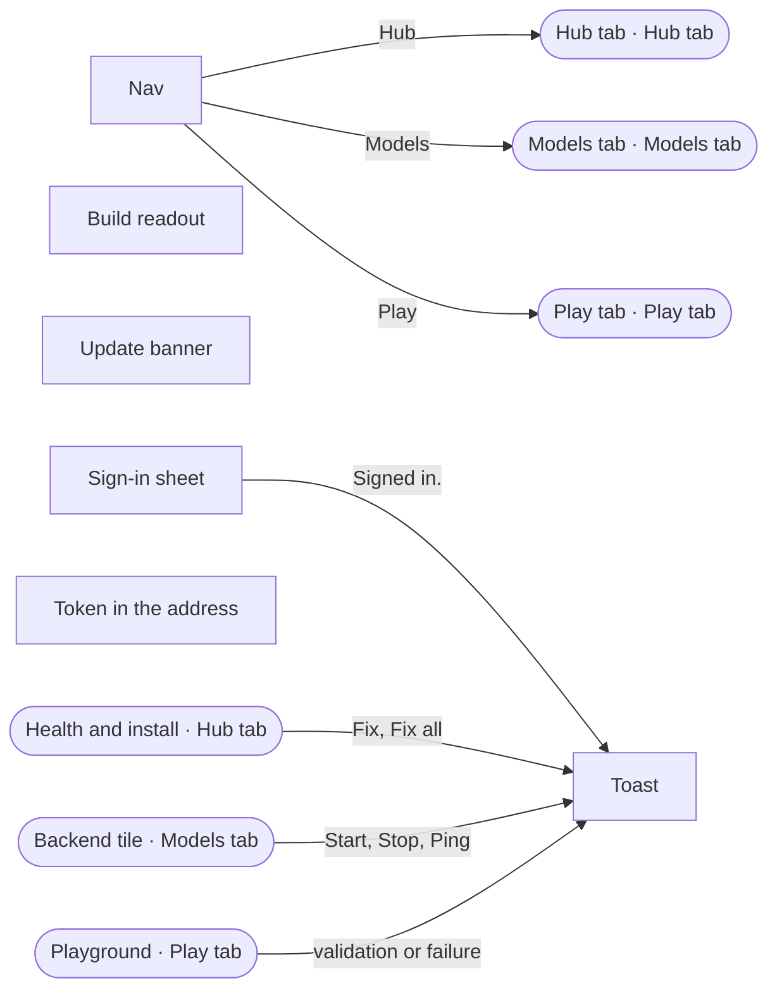
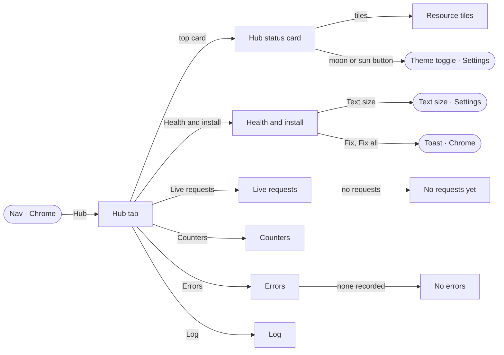
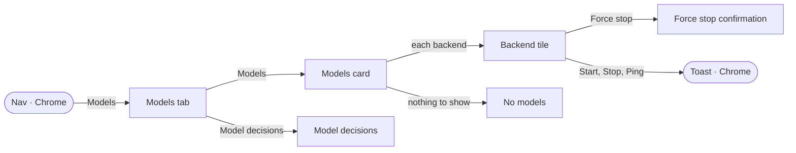
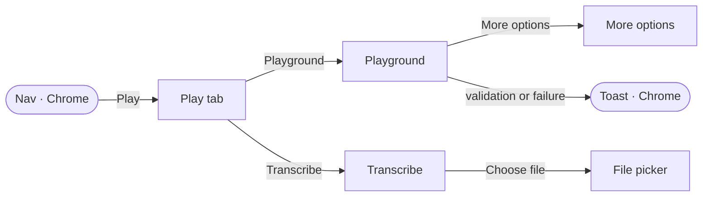
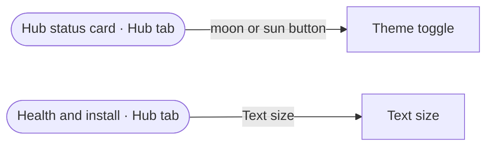
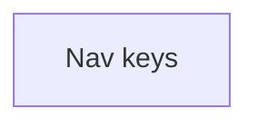

<!-- Generated from docs/ux-surfaces.yaml by scripts/ux_surface_map.py. Do not edit: change the map and re-run. -->

# UX surface map: local-llm-hub-lite

Every surface a person can reach in this app, each under a stable id that its root element carries as `data-surface`. Each area has a diagram of how its surfaces connect; a rounded node is a surface in another area.

The admin SPA served at /admin/ is one page with three tabs, Hub, Models and Play, switched by the floating nav pill (a left rail from 1100 px on a fine pointer). Every card is a native details disclosure, so Enter and Space on its summary open and close it. Loopback callers are trusted and never see the sign-in sheet; a caller from another address sees it on the first 401. Settings has no tab of its own. The two choices it holds (theme, text size) sit on the Hub tab. The text-size and theme choices are stored in the browser (localStorage), the open tab too, and the Models tab's Active only filter. A ?token= query parameter on the page URL is stored as the bearer token and then stripped from the address bar.

Walked 2026-11-18 against build `03ee6f3`, at widths 390, 1280, themes light, dark.

## Areas

| Area | Surfaces |
|---|---|
| [Chrome](#chrome) | 6 |
| [Hub tab](#hub-tab) | 10 |
| [Models tab](#models-tab) | 6 |
| [Play tab](#play-tab) | 5 |
| [Settings](#settings) | 2 |
| [Keys and gestures](#keys-and-gestures) | 1 |

## Chrome

What every tab shares. The nav, the build footer, the toast and the two banners or sheets that can appear over any tab.

### `chrome.nav` Nav

- **Root:** `data-surface`
- **Reach:** always on screen
- **Holds:** three tabs in order, Hub, Models and Play, each a glyph over its label
- **Does:**
  - switches the visible tab and remembers it for the next visit
  - starts the Hub tab's event streams when Hub opens and stops them when it closes
- **Phone:** a floating pill at the top of the screen
- **Desktop:** a left rail from 1100 px
- **Why:** the fleet navigation contract, a floating pill on a phone and a left rail on a wide fine pointer
- **Leads to:**
  - [Hub tab](#hubscreen-hub-tab) (Hub)
  - [Models tab](#modelsscreen-models-tab) (Models)
  - [Play tab](#playgroundscreen-play-tab) (Play)

### `chrome.toast` Toast

- **Root:** `data-surface`
- **Reach:** opens by itself after Start, Stop, Force stop, Ping, Fix, Fix all, a signed-in retry, and every validation or request failure
- **Holds:** one line of text, tinted only when it reports an error
- **Does:** hides itself after about 2 s, or 4.5 s for an error
- **States:** success and neutral messages render untinted, errors render tinted
- **Why:** one toast element at body level, outside the scrolling main, so it stays fixed on iOS

### `chrome.build-readout` Build readout

- **Root:** `data-surface`
- **Reach:** the foot of every tab
- **Holds:** the running build, "Build" followed by the short git sha and the build time
- **States:** reads "unknown" for the sha when the version endpoint is unreachable

### `app.update-banner` Update banner

- **Root:** `data-surface`
- **Reach:** appears over any tab when the server reports a newer build than the page booted with, checked every 5 min and when the tab becomes visible
- **Holds:**
  - the text "New version available"
  - Reload
  - a dismiss button
- **Does:**
  - Reload refreshes the page onto the new build
  - the dismiss button hides the banner until the server moves to yet another build
- **Why:** stamped by the vendored build-watch component, which builds the banner itself

### `shared.login` Sign-in sheet

- **Root:** `data-surface`
- **Reach:** opens by itself on any 401 from the admin API, which only a non-loopback caller without a valid bearer token gets
- **Holds:**
  - the title "Sign in" and the hint "This hub is locked. Enter the configured password."
  - a password field
  - the Sign in button, disabled until something is typed
- **Does:**
  - posts the password to /admin/api/login and stores the returned token
  - on success closes, shows a "Signed in." toast and reloads the hub, models and install data
- **States:** wrong password, not set up on this server, too many attempts (with the wait), cannot reach the app
- **Why:** the one fleet sign-in sheet, vendored so the password input exists nowhere else
- **Leads to:** [Toast](#chrometoast-toast) (Signed in.)

### `chrome.token-link` Token in the address

- **Root:** none — a query parameter read at boot, with nothing drawn
- **Reach:** opening /admin/?token=VALUE, the form the hub prints for a non-loopback client
- **Does:** stores the token as the bearer token for every later call and removes it from the address bar

## Hub tab

Live status of the hub process and its diagnostics. Only this tab holds the two event streams, which stop while another tab is open.

### `hub.screen` Hub tab

- **Root:** `data-surface`
- **Reach:** the Hub tab, the default on a first visit
- **Holds:**
  - the Hub status card
  - Health and install
  - Live requests, Counters, Errors and Log, each folded
- **Why:** the five diagnostics are folded by default so the tab opens on status and nothing scrolls past noise
- **Leads to:**
  - [Hub status card](#hubstatus-hub-status-card) (top card)
  - [Health and install](#hubinstall-health-and-install) (Health and install)
  - [Live requests](#hublive-requests-live-requests) (Live requests)
  - [Counters](#hubcounters-counters) (Counters)
  - [Errors](#huberrors-errors) (Errors)
  - [Log](#hublog-log) (Log)

### `hub.status` Hub status card

- **Root:** `data-surface`
- **Reach:** the top of the Hub tab
- **Holds:**
  - the title "Hub" with a live dot and word
  - the process id and the uptime
  - the sparkline tiles
  - the theme toggle, right-aligned in the header
- **Does:** polls the hub every few seconds and refreshes the dot, the PID and the uptime
- **States:**
  - up (green) while the status call answers
  - unreachable (red) when it fails
  - checking… before the first answer
- **Leads to:**
  - [Resource tiles](#hubsparklines-resource-tiles) (tiles)
  - [Theme toggle](#settingstheme-theme-toggle) (moon or sun button)

### `hub.sparklines` Resource tiles

- **Root:** `data-surface`
- **Reach:** inside the Hub status card, redrawn every 2 s while the Hub tab is open
- **Holds:**
  - a CPU tile
  - a GPU utilisation tile, only when a GPU is reported
  - a RAM tile
  - a VRAM tile, only when a GPU is reported
- **States:**
  - a tile with fewer than two samples shows its percentage with no line
  - empty before the first sample arrives

### `hub.install` Health and install

- **Root:** `data-surface`
- **Reach:** the Hub tab's second card, folded
- **Holds:**
  - a summary line, "N checks · overall" followed by the worst status
  - one row per check with a status glyph, its label and its detail
  - a Fix button on a row whose check is missing or failed
  - the Text size choice
  - Fix all and Re-check
- **Does:**
  - Fix runs that one repair, toasts the result and re-checks
  - Fix all runs every repair in turn and re-checks
  - Re-check reads the status again
- **States:**
  - the buttons read "Running…" while a repair runs and are disabled
  - a failed Fix toasts the error and the button reads Retry
  - overall status colours the summary ok, warn, missing or error
- **Why:** one card holds both the checks and their repairs, so nothing needs a terminal
- **Leads to:**
  - [Text size](#settingstext-size-text-size) (Text size)
  - [Toast](#chrometoast-toast) (Fix, Fix all)

### `hub.live-requests` Live requests

- **Root:** `data-surface`
- **Reach:** the Hub tab's third card, folded
- **Holds:**
  - a count badge
  - the 50 newest requests, newest first, each with its time, model, backend, status and latency, and its token counts
  - a note that audio posted straight to the whisper port is not shown
- **Does:** fills from an event stream that reconnects by itself and drops repeats
- **States:** empty, see the empty state
- **Leads to:** [No requests yet](#hublive-requests-empty-no-requests-yet) (no requests)

### `hub.live-requests-empty` No requests yet

- **Root:** `data-surface`
- **Reach:** inside Live requests while the ring is empty
- **Holds:** a glyph and the line "No requests yet — the ring fills as clients call the hub."

### `hub.counters` Counters

- **Root:** `data-surface`
- **Reach:** the Hub tab's fourth card, folded
- **Holds:**
  - a table with one row per backend and its requests, errors, p50, p95 and in and out tokens
  - a note that the counts reset when the hub restarts
- **States:** an empty table before any request

### `hub.errors` Errors

- **Root:** `data-surface`
- **Reach:** the Hub tab's fifth card, folded
- **Holds:**
  - a count badge
  - the newest non-2xx responses, each with its time, model, backend, status and the first 80 characters of the error
- **Leads to:** [No errors](#huberrors-empty-no-errors) (none recorded)

### `hub.errors-empty` No errors

- **Root:** `data-surface`
- **Reach:** inside Errors while no non-2xx response is in the ring
- **Holds:** a check glyph and the line "No non-2xx responses in the ring."

### `hub.log` Log

- **Root:** `data-surface`
- **Reach:** the Hub tab's last card, folded
- **Holds:**
  - a Pause button that turns into Resume
  - the live tail of the hub's own log, 800 lines at most
- **Does:** Pause stops appending lines and Resume starts again, without closing the stream

## Models tab

One tile per backend the registry enables on this machine, and the role assignments.

### `models.screen` Models tab

- **Root:** `data-surface`
- **Reach:** the Models tab
- **Holds:**
  - the Models card, open
  - Model decisions, folded
- **Leads to:**
  - [Models card](#modelslist-models-card) (Models)
  - [Model decisions](#modelsdecisions-model-decisions) (Model decisions)

### `models.list` Models card

- **Root:** `data-surface`
- **Reach:** the Models tab's first card, open by default
- **Holds:**
  - an Active only toggle in the header
  - one explanatory line
  - one tile per enabled backend
- **Does:**
  - Active only hides tiles that are stopped, leaving loading, failed, adopted, unknown and ready ones; the choice is remembered
  - refreshes every 5 s while the tab is open, keeping each tile's element so focus survives
- **States:** Active only is on by default, so a hub with nothing running opens on the empty state
- **Why:** the toggle sits in the card header so the filter is one tap from the list it filters
- **Leads to:**
  - [Backend tile](#modelsrow-backend-tile) (each backend)
  - [No models](#modelsempty-no-models) (nothing to show)

### `models.row` Backend tile

- **Root:** `data-surface`
- **Reach:** one per backend inside the Models card
- **Holds:**
  - the display name
  - a state pill, one of stopped, loading, running, adopted, failed or unknown, or the backend name for an alias with no process of its own
  - Start, Stop and Ping glyph buttons, and Force stop on an adopted tile
  - a meta line with the backend, the engine and exact runtime model for a Foundry Local row, the port, the process id when adopted, the failure reason, the aliases and the estimated memory
  - a startup badge, eager or on-demand with its live word
- **Does:**
  - Start launches the backend and toasts, Stop ends it, Ping probes it and toasts the status and latency
  - Force stop asks first, then kills whatever holds the port
- **States:**
  - Start is on for a stopped or failed tile, Stop for anything the hub started or is loading, Ping once it serves
  - an alias tile has Ping only
  - on-demand reads loaded while it answers and idle-unloaded when not
- **Why:** every control is a glyph with a title so a tile stays one line on a phone
- **Leads to:**
  - [Force stop confirmation](#modelsforce-stop-confirm-force-stop-confirmation) (Force stop)
  - [Toast](#chrometoast-toast) (Start, Stop, Ping)

### `models.force-stop-confirm` Force stop confirmation

- **Root:** none — the browser's own confirm dialog, which has no element
- **Reach:** Force stop on an adopted tile
- **Holds:** the text naming the port and the process id that will be killed
- **Does:** OK kills the process on that port, Cancel changes nothing

### `models.empty` No models

- **Root:** `data-surface`
- **Reach:** inside the Models card when no tile is visible
- **Holds:** a glyph and one line
- **States:**
  - an empty registry reads "No models enabled for this host — check config/models.yaml."
  - a filter that hides every tile reads "No active models right now — turn off “Active only” to see the full list."

### `models.decisions` Model decisions

- **Root:** `data-surface`
- **Reach:** the Models tab's second card, folded
- **Holds:** a Roles list with each role and the model it resolves to, plus its fallbacks
- **Does:** reads the assignments only when opened, and again on each reopen, with no timer
- **States:**
  - while the call runs it reads "Loading…"
  - a failed call reads "Could not load role data."
  - with no roles it reads "No roles configured in config/models.yaml."

## Play tab

One-off requests through the admin API (never counted as client traffic in the hub's own request ring).

### `playground.screen` Play tab

- **Root:** `data-surface`
- **Reach:** the Play tab
- **Holds:** the Playground card and the Transcribe card, both folded
- **Leads to:**
  - [Playground](#playgroundtester-playground) (Playground)
  - [Transcribe](#playgroundtranscribe-transcribe) (Transcribe)

### `playground.tester` Playground

- **Root:** `data-surface`
- **Reach:** the Play tab's first card, folded
- **Holds:**
  - a model picker listing the chat backends
  - a System field and a Prompt field
  - More options
  - Send and Clear
  - the round-trip time, the Reply and a Usage grid of input, output and cache tokens
- **Does:**
  - Send posts the prompt and shows the reply, its time and its token usage
  - Clear empties the reply, the usage and the time
- **States:**
  - with no model or no prompt a toast says "Pick a model first." or "Prompt is empty." and nothing is sent
  - the reply reads "…" while waiting and "[status] message" on a failure
- **Leads to:**
  - [More options](#playgroundmore-options-more-options) (More options)
  - [Toast](#chrometoast-toast) (validation or failure)

### `playground.more-options` More options

- **Root:** `data-surface`
- **Reach:** the folded More options row inside the Playground card
- **Holds:** the Max tokens presets 256, 512, 2048 and 8192, and a number field
- **Does:** a preset fills the number field, and typing in the field lights the matching preset, or none

### `playground.transcribe` Transcribe

- **Root:** `data-surface`
- **Reach:** the Play tab's second card, folded
- **Holds:**
  - Choose file and the chosen name
  - Transcribe, disabled until a file is chosen
  - the round-trip time, the Transcript and the model that served it
- **Does:** Transcribe sends the audio through the hub and prints the text
- **States:** the transcript reads "…" while waiting and "[status] message" on a failure
- **Leads to:** [File picker](#playgroundfile-picker-file-picker) (Choose file)

### `playground.file-picker` File picker

- **Root:** none — the browser's own file chooser, which has no element
- **Reach:** Choose file in Transcribe
- **Does:** takes one audio file and shows its name beside the button

## Settings

The two display choices, both persisted in the browser.

### `settings.theme` Theme toggle

- **Root:** `data-surface`
- **Reach:** the moon or sun button in the Hub status card's header
- **Does:** flips between light and dark and remembers the choice
- **States:** with no stored choice the page follows the system colour scheme
- **Why:** the glyph shows the action, a sun to go light and a moon to go dark

### `settings.text-size` Text size

- **Root:** `data-surface`
- **Reach:** the Text size row inside Health and install
- **Holds:** a three-way control, Small, Default and Large
- **Does:** rescales the type on every tab and remembers the step

## Keys and gestures

### `keys.nav-arrows` Nav keys

- **Root:** none — key handling on the nav, with nothing drawn
- **Reach:** focus on a tab, then an arrow key, Home or End
- **Does:** the arrow keys move to the neighbouring tab (wrapping at the ends) and open it; Home and End jump to the first and last

## Link index

| From | Via | To |
|---|---|---|
| [Nav](#chromenav-nav) | Hub | [Hub tab](#hubscreen-hub-tab) |
| [Nav](#chromenav-nav) | Models | [Models tab](#modelsscreen-models-tab) |
| [Nav](#chromenav-nav) | Play | [Play tab](#playgroundscreen-play-tab) |
| [Sign-in sheet](#sharedlogin-sign-in-sheet) | Signed in. | [Toast](#chrometoast-toast) |
| [Hub tab](#hubscreen-hub-tab) | top card | [Hub status card](#hubstatus-hub-status-card) |
| [Hub tab](#hubscreen-hub-tab) | Health and install | [Health and install](#hubinstall-health-and-install) |
| [Hub tab](#hubscreen-hub-tab) | Live requests | [Live requests](#hublive-requests-live-requests) |
| [Hub tab](#hubscreen-hub-tab) | Counters | [Counters](#hubcounters-counters) |
| [Hub tab](#hubscreen-hub-tab) | Errors | [Errors](#huberrors-errors) |
| [Hub tab](#hubscreen-hub-tab) | Log | [Log](#hublog-log) |
| [Hub status card](#hubstatus-hub-status-card) | tiles | [Resource tiles](#hubsparklines-resource-tiles) |
| [Hub status card](#hubstatus-hub-status-card) | moon or sun button | [Theme toggle](#settingstheme-theme-toggle) |
| [Health and install](#hubinstall-health-and-install) | Text size | [Text size](#settingstext-size-text-size) |
| [Health and install](#hubinstall-health-and-install) | Fix, Fix all | [Toast](#chrometoast-toast) |
| [Live requests](#hublive-requests-live-requests) | no requests | [No requests yet](#hublive-requests-empty-no-requests-yet) |
| [Errors](#huberrors-errors) | none recorded | [No errors](#huberrors-empty-no-errors) |
| [Models tab](#modelsscreen-models-tab) | Models | [Models card](#modelslist-models-card) |
| [Models tab](#modelsscreen-models-tab) | Model decisions | [Model decisions](#modelsdecisions-model-decisions) |
| [Models card](#modelslist-models-card) | each backend | [Backend tile](#modelsrow-backend-tile) |
| [Models card](#modelslist-models-card) | nothing to show | [No models](#modelsempty-no-models) |
| [Backend tile](#modelsrow-backend-tile) | Force stop | [Force stop confirmation](#modelsforce-stop-confirm-force-stop-confirmation) |
| [Backend tile](#modelsrow-backend-tile) | Start, Stop, Ping | [Toast](#chrometoast-toast) |
| [Play tab](#playgroundscreen-play-tab) | Playground | [Playground](#playgroundtester-playground) |
| [Play tab](#playgroundscreen-play-tab) | Transcribe | [Transcribe](#playgroundtranscribe-transcribe) |
| [Playground](#playgroundtester-playground) | More options | [More options](#playgroundmore-options-more-options) |
| [Playground](#playgroundtester-playground) | validation or failure | [Toast](#chrometoast-toast) |
| [Transcribe](#playgroundtranscribe-transcribe) | Choose file | [File picker](#playgroundfile-picker-file-picker) |
